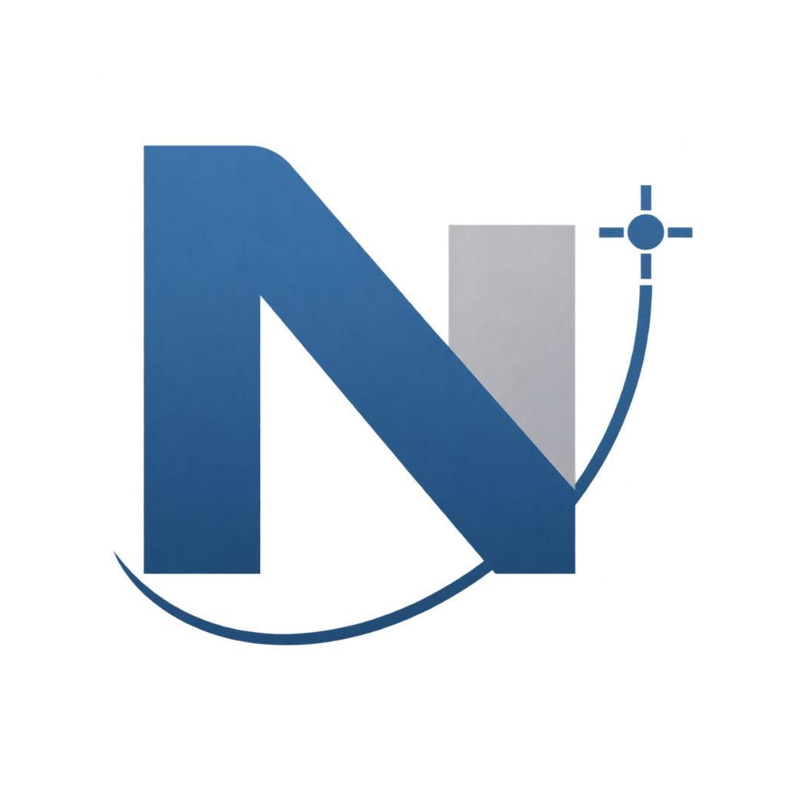
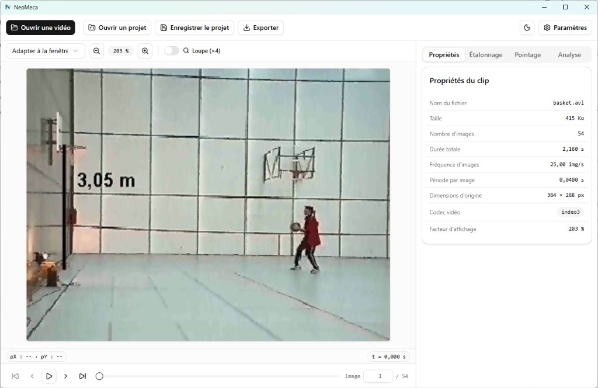
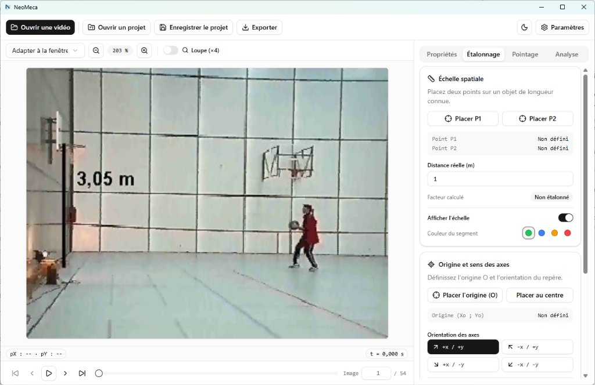
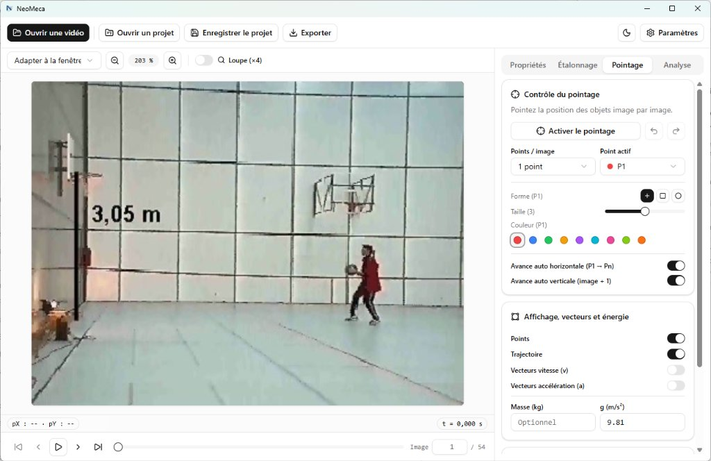
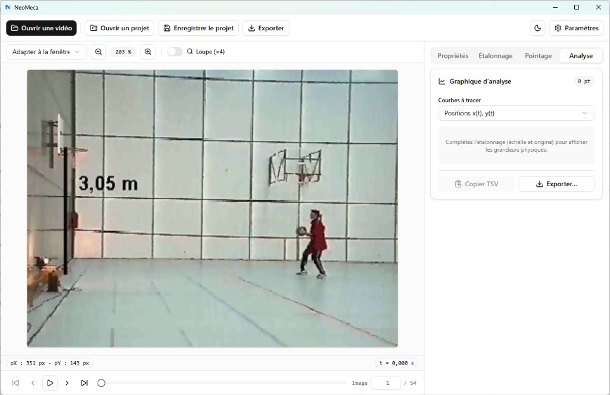
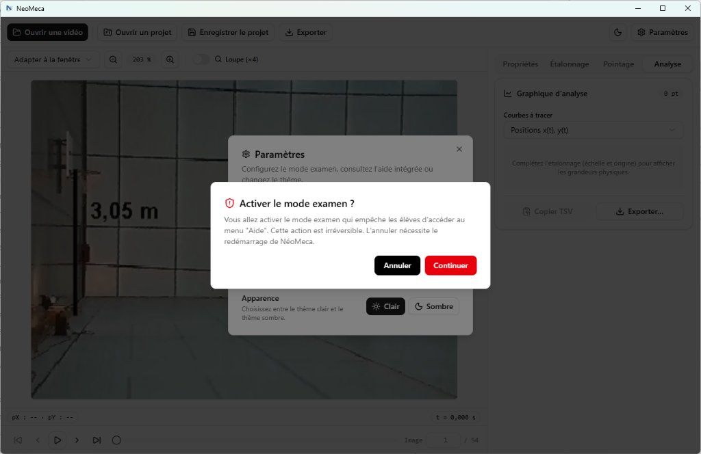

<p align="center">
  
</p>

# NéoMeca

**NéoMeca** est un logiciel libre de pointage vidéo et d'analyse mécanique pour la physique-chimie, conçu comme un remplaçant moderne d'AviMéca.

La vocation première de NéoMeca est pédagogique. J'ai créé ce logiciel dans l'optique de simplifier et d'améliorer l'expérience des élèves et des professeurs au cours des TP et des ECE. Je suis prêt à en partager la maintenance avec tous ceux qui voudraient y contribuer.

Il convient de dire dans le même temps que ce logiciel a été pensé, et c'est rare, pour une utilisation sur Linux, afin de mettre tous les élèves de tous les établissements dans une condition d'égalité. L'universalité est un beau principe, qui nous est cher, aussi dans le domaine numérique.

Tous les bugs, toutes les sources d'inconfort se doivent d'être signalés afin que je puisse y remédier le plus rapidement possible.



### Aperçu des autres modules

| Étalonnage | Pointage |
| :---: | :---: |
|  |  |

| Analyse | Mode examen |
| :---: | :---: |
|  |  |

## Fonctionnalités principales

- **Large compatibilité vidéo** : lecture image par image exacte des fichiers `.mp4`, `.mov`, `.avi` (y compris les anciens codecs pédagogiques comme Indeo ou Cinepak), `.mkv` et `.webm`.
- **Étalonnage et repère** : définition de l'échelle spatiale en deux points, origine du repère, quatre orientations d'axes et choix de l'image `t = 0`.
- **Pointage multi-points et loupe** : suivi jusqu'à 9 objets par image avec avance automatique, loupe de précision `×4`, personnalisation des marqueurs, historique Annuler/Rétablir et protection contre la fermeture accidentelle.
- **Calculs, vecteurs et graphiques** : calcul automatique des vitesses, accélérations et énergies (`Ec`, `Ep`, `Em`), affichage des vecteurs sur la vidéo, courbes interactives et régression linéaire.
- **Exports et projets** : export natif Excel (`.xlsx`), `.csv` / `.txt`, Regressi (`.rw3`), copie presse-papier, image annotée (`.png`) et sauvegarde/réouverture de séance (`.neomeca.json`).

## Mode examen

NéoMeca intègre un **mode examen** strict, conçu sur le même principe que celui d'une calculatrice. Une fois activé après confirmation dans les paramètres, toute l'aide intégrée est rendue indisponible pour les élèves. Cette activation est irréversible pendant la session en cours : sortir du mode examen nécessite impérativement de redémarrer NéoMeca.

## Sécurité et performances (Éducation nationale et établissements)

NéoMeca est codé en **Rust**, un langage très moderne, très rapide et surtout sécurisé, qui réduit au maximum le risque de vulnérabilité sur les machines et offre des performances optimales, même sur des postes scolaires modestes. Le binaire reste léger (environ 6 Mo) et s'appuie sur la WebView native du système sans embarquer de navigateur complet.

## Configuration minimale requise

- **Windows** : Windows 10 (64 bits, version 1803 ou ultérieure) ou Windows 11, avec WebView2 Runtime (installé automatiquement par l'installeur si nécessaire).
- **Linux** : distribution 64 bits (`x86_64`) récente avec WebKitGTK 4.1 (`libwebkit2gtk-4.1`) et GTK 3 (paquets `.AppImage`, `.deb` et `.zip` portable).
- **Traitement vidéo** : `ffmpeg` et `ffprobe` disponibles dans le `PATH` système (ou placés dans un dossier `bin/` à côté de l'exécutable).

## Pile technique

- Tauri v2 (Rust)
- React, TypeScript, Tailwind CSS et shadcn/ui
- FFmpeg et FFprobe pour la lecture des métadonnées et l'extraction exacte d'images
- `rust_xlsxwriter` pour l'export natif Excel (`.xlsx`)

## Commandes de développement

```bash
npm install
npm run dev
npm run tauri dev
npm run check
npm run test:types
npm run test:unit
```

Côté Rust (dans `src-tauri/`) :

```bash
cargo check
cargo clippy --all-targets
cargo nextest run --workspace
```

## Licence et droits d'auteur

Copyright (c) 2026 `ainsiparlaitzarathoustra`.
Distribué sous licence [Mozilla Public License 2.0](LICENSE).
